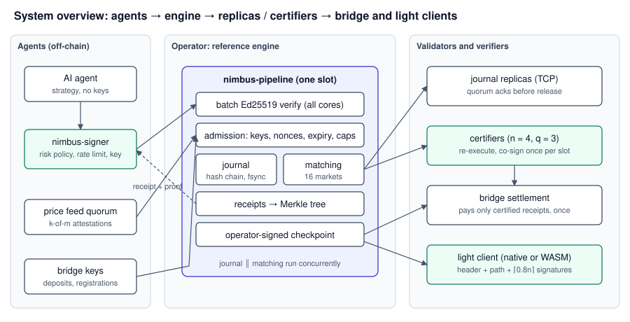
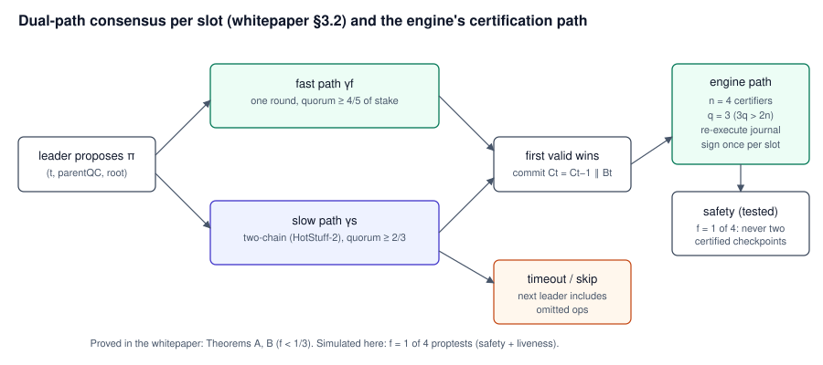
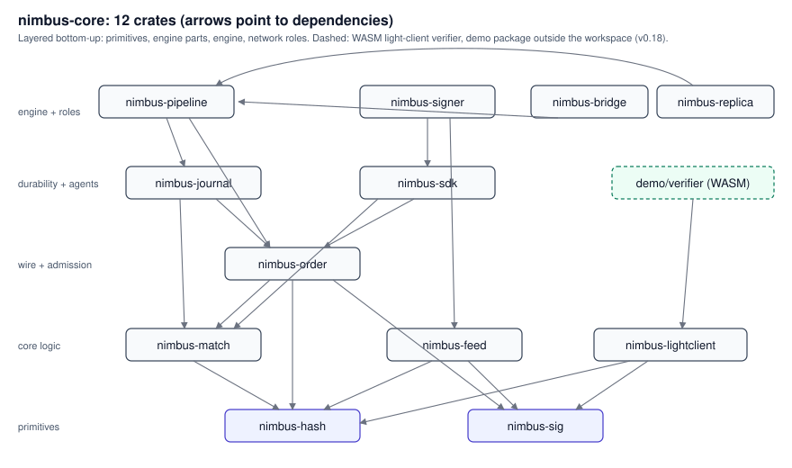
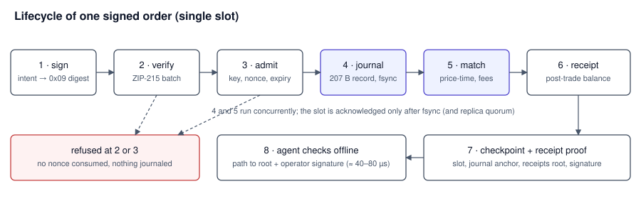
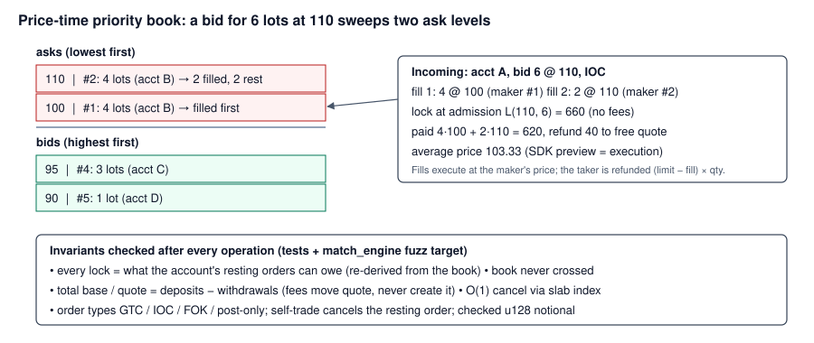
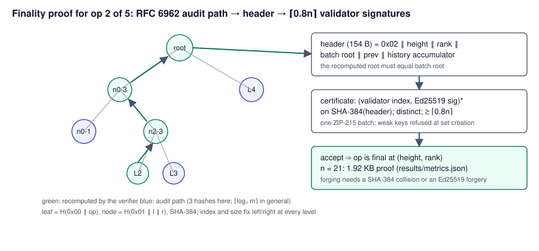

# Nimbus Chain: Certified Operations Tapes at Agent Speed

**A dissertation on the design, implementation and evaluation of a dual-path BFT chain for autonomous-agent trading**

*Agent-speed SI blockchain.*

Brandon "Braylo" Lopez · NimBros PBC · nimbus-core v0.18.0 · Working text derived from Whitepaper V3 · Not investment advice

---

## Abstract

Nimbus Chain certifies an ordered operations tape — orders, cancels, withdrawals, deposits — and the state transitions of the autonomous agents that write it. The protocol (Whitepaper V3) races a single-round fast path at a 4/5 quorum against a two-chain slow path at 2/3, and keeps safety at Byzantine stake f < 1/3. This dissertation covers the part of the design that exists as code: `nimbus-core`, a reference engine of twelve Rust crates. The engine verifies Ed25519 signatures in batches, admits entries under nonce, expiry and quota rules, writes a hash-chained journal with one fsync per slot, matches orders on a price-time book with exact integer fees, emits a receipt with a Merkle proof for every state change, and signs a checkpoint per slot. Replicas hold the journal; certifiers re-execute it and co-sign checkpoints; a bridge pays only against certified receipts; a light client verifies finality proofs, natively or in a browser through WebAssembly.

The evaluation separates three kinds of evidence. **Proved** results are the whitepaper's theorems and are cited, not re-proved. **Simulated** results are model checks: here, a 4-validator network with one Byzantine member, run as property tests. **Measured** results are timings on real hardware, generated into `results/metrics.json` by one command and copied into this text by a script that CI checks. The chapter on limitations lists what is not established, including every production property the engine does not yet have.

## Contents

1. Introduction and thesis
2. Background
3. Architecture: the dual path
4. Signing and hashing
5. Matching
6. Journal and replication
7. Light client
8. Agent accounts and SDK
9. Evaluation
10. Security and fuzzing
11. Limitations
12. Future work
13. References

---

## 1 · Introduction and thesis

Autonomous agents now place and cancel orders faster than a person can read them. When an agent's action moves value, three questions follow: was the action authorised, did it execute as stated, and can anyone check both later without trusting the operator. Blockchains answer the third question, but most answer it slowly: the documented finality of a fast general-purpose chain such as Sui is about 390 ms, and Nakamoto-style chains give only probabilistic finality.

**Thesis.** A trading tape for agents can be (a) certified by a Byzantine-fault-tolerant validator set with deterministic finality, (b) executed by an engine whose every output is reproducible from a replicated journal, and (c) verified by a small client from a proof of a few kilobytes — and the engine side of this can run at more than 10⁵ signed entries per second on a laptop-class CPU.

Part (a) is the subject of the whitepaper's proofs (Theorems A, A\*, B). Parts (b) and (c) are the subject of this work: they are implemented, tested (309 tests, 4 fuzz targets) and measured.

**Contributions of this dissertation.**

- A description of `nimbus-core` v0.18 as a system: twelve crates, their contracts and how they compose (Chapters 3–8).
- A wire codec and a WebAssembly build of the light-client verifier, with a replayed tape that a browser checks end to end (Chapter 7).
- A simulated-network test of checkpoint certification with n = 4 validators and f = 1 Byzantine member: safety and liveness as property tests (Chapter 6, Chapter 10).
- Four coverage-guided fuzz targets for the attack surfaces that parse untrusted bytes or hold value (Chapter 10).
- An evaluation whose numbers are generated, dated and machine-labelled, on a laptop and on a cloud VM (Chapter 9).

*Figure 1 — System overview: agents sign through a key-isolating signer; the engine verifies, admits, journals, matches and checkpoints; replicas and certifiers hold and re-execute the journal; the bridge and light clients act only on proofs.*

## 2 · Background

**Byzantine fault tolerance.** PBFT [1] showed that n ≥ 3f + 1 replicas can agree despite f arbitrary faults, with quorums of 2f + 1 whose pairwise intersection contains an honest replica. HotStuff [2] made the protocol linear and pipelined; HotStuff-2 [3] reduced it to two phases while keeping responsiveness. Safety holds always; liveness holds after the global stabilisation time of the partial-synchrony model [4].

**Single-round fast paths.** Protocols in the Votor/Alpenglow pattern finalise in one round when a 4/5 quorum votes, but lose liveness below that threshold. Nimbus runs both paths per slot and takes the first valid certificate (Chapter 3).

**Merkle commitments.** RFC 6962 [23] defines an unpadded binary Merkle tree split at the largest power of two below the leaf count, with distinct leaf and node prefixes. An audit path of ⌈log₂ m⌉ hashes proves inclusion of one leaf.

**Ed25519 and its verification rules.** RFC 8032 [26] permits two verification equations. They disagree on signatures with small-order components, and batch verification agrees with single verification only under the cofactored equation. ZIP-215 [27] fixes the cofactored rule and the acceptance of encodings; Nimbus adopts it everywhere and also refuses small-order public keys (Chapter 4).

**Agents as principals.** Work on AI safety [13]–[15] argues for external, checkable constraints on what an agent can do. Nimbus treats an agent as an account whose actions pass a published risk policy before they are signed, and whose results are returned as receipts it can check itself (Chapter 8).

## 3 · Architecture: the dual path

**Consensus (whitepaper §3.2).** For slot t a leader proposes π = (t, parentQC, root, leader). Two certificates compete: a fast certificate γf of votes from ≥ 4/5 of stake in one round, and a slow certificate γs of ≥ 2/3 with a HotStuff-2 child QC. The first valid one commits the batch. If neither forms within the slot, the next leader must include the omitted operations, which bounds censorship delay geometrically (whitepaper Prop. 14′). Theorems A and B show that no two certificates bind distinct roots at one slot while f < 1/3.

*Figure 2 — Dual-path consensus per slot, and the engine's own certification path (n = 4 certifiers, quorum 3).*

**The engine path.** The reference engine does not yet implement the leader rotation and vote collection of the full protocol. It implements the data path every validator needs and a certification rule with the same quorum arithmetic:

- the **operator** runs the pipeline and signs one checkpoint per slot: (slot, journal anchor, receipts root, receipt count);
- **replicas** receive the journal over authenticated TCP and acknowledge only what they made durable; the engine releases a slot's results when `need` replicas hold it;
- **certifiers** are replicas that re-execute every slot with the same deterministic code and co-sign an operator checkpoint only if it equals their own derivation, at most once per slot, recorded durably before the signature leaves;
- the **bridge** accepts a checkpoint only with co-signatures from a quorum q where 3q > 2n.

With f < n/3 faulty certifiers, a fabricated checkpoint cannot gather q signatures, and two certified checkpoints for one slot would identify 2q − n > f validators that signed both.

**Crate structure.** Figure 3 shows the twelve crates. Primitives (`nimbus-hash`, `nimbus-sig`) have no internal dependencies. `nimbus-match` and `nimbus-order` hold the book and the wire formats. `nimbus-journal` and `nimbus-pipeline` hold durability and the slot loop. `nimbus-replica`, `nimbus-bridge`, `nimbus-signer` and `nimbus-feed` are network roles. `nimbus-lightclient` depends only on the primitives, which is what lets it compile to WebAssembly.

*Figure 3 — Crate dependency graph.*

**One slot.** The pipeline (Figure 4) processes a slot in six stages: batch signature verification on all cores; ordered admission; the journal write and fsync running concurrently with matching; receipts for every change; a receipt Merkle tree; and the signed checkpoint. With cross-slot pipelining, verification of slot s + 1 overlaps the commit of slot s.

*Figure 4 — Lifecycle of one signed order.*

## 4 · Signing and hashing

**Domain-separated SHA-384.** Every hash in the system is H(tag ‖ data) with a one-byte tag from a registry (whitepaper Lemma 9″): 0x00/0x01 batch leaf/node, 0x02 header, 0x03 skip, 0x04/0x05 history, 0x06/0x07 state, 0x08 timeout, then the engine's 0x09 order, 0x0A feed, 0x0B journal, 0x0C checkpoint, 0x0F action, 0x10 bridge, 0x11 replication, 0x12 snapshot. Tags make an encoding injective across message types: a signature over an order digest can never be replayed as an action, and a node hash can never be read as a leaf. The test suite checks the registry against the whitepaper's table (`registry_vectors.rs`) and checks domain separation directly.

**Merkle roots.** `nimbus-hash` provides a reference RFC 6962 root, a streaming (frontier) root that absorbs items as they arrive and finishes with at most ⌊log₂ m⌋ + 1 hashes, a parallel root, and an indexed tree with O(log n) paths. Tests check that all four agree and that every audit path verifies at its own index only, for 26 tree sizes from 0 to 2,049.

**One Ed25519 rule.** `nimbus-sig` defines `CheckedKey` — a key that decodes, is canonically encoded and is not of small order — and verifies under ZIP-215. Under this rule a randomised batch accepts exactly when every member verifies singly (except with probability ≤ 2⁻¹²⁸). `verify_all` splits work by key across cores and bisects failed batches to find exactly the invalid signatures; `SpinPool` provides never-sleeping workers for sub-millisecond slots. The tests list all eight small-order points and two non-canonical encodings and check each is refused, and check nine adversarial patterns of invalid signatures (none, all, first, last, alternating, blocks) at batch sizes 1, 4, 16 and 64.

**Why weak keys matter.** Under a small-order key, R = identity and s = 0 verify for every message. The whitepaper records this attack executed against engine v0.3: an order admitted with no private key. `ValidatorSet::new` and `Admission::register` refuse such keys.

## 5 · Matching

*Figure 5 — A bid sweeping two ask levels, and the invariants checked after every operation.*

**Model.** Prices are integer ticks and quantities integer lots; notional is computed in checked u128. Each resting order locks exactly what it can owe: a bid locks L(p, r) quote, an ask locks r base. Fills execute at the maker's price, and a bid taker gets back (limit − fill price) × quantity from its lock. A taker never fills against its own account: the resting order is cancelled instead (self-trade prevention).

**Order types.** GTC rests; IOC releases its remainder; fill-or-kill fills in full or is refused with state untouched; post-only is refused if it would take, so it can only make.

**Fees.** Each fill charges the taker ⌈n·t/10⁴⌉ and the maker ⌈n·m/10⁴⌉, where n is the fill's notional; an optional maker rebate ⌊n·ρ/10⁴⌋ is paid out of the taker fee (ρ ≤ t). With fees, a bid locks L(p, r) = p·r + ⌈p·r·B/10⁴⌉ + r with B = max(t, m), which provably covers every fill and its fee (whitepaper Prop. Z5). Fees move quote between accounts; supply is conserved exactly.

**Determinism and parallelism.** Markets share nothing, so a batch runs one market per core, and the result does not depend on the thread count. `state_hash` commits to the full book and balances.

**Evidence.** Property tests and a differential test against a naive reference engine (six fee schedules, two with rebates, all four order types); 27 hand-worked scenarios; the `match_engine` fuzz target, which checks all invariants after every operation of arbitrary sequences and re-runs each sequence to compare state hashes.

## 6 · Journal and replication

**Journal.** Each record is len (2) ‖ seq (8) ‖ slot (8) ‖ entry ‖ chain (48), where chainᵢ = H(0x0B ‖ chainᵢ₋₁ ‖ len ‖ seq ‖ slot ‖ entry). An order record is 207 bytes. Opening a journal verifies the whole chain: a partial last record (a crash mid-write) is truncated; any modified, reordered or removed record is reported at its position. A chain alone cannot show that whole records were cut from the end, so published anchors (len, head) are checked by `open_anchored`. Group commit writes a slot with one `write` and makes it durable with one fsync.

**Replication.** A replica verifies shipped records against its own chain before writing them, so it always holds a byte-identical prefix of the primary's journal and can be opened as a primary after failover. Shipments and acknowledgements are authenticated per link (Ed25519 or HMAC-SHA384, domain 0x11). Two modes exist: blocking (acknowledge a slot only when `need` replicas hold it) and windowed (keep committing, release results in slot order once replicated). Polled, never-sleeping I/O cuts the measured per-hop cost on loopback from about 1 ms to about 0.11 ms at p50.

**Deterministic replay.** `Replayer` re-executes journal records and derives the same checkpoint body the engine signed. New property tests in this version (`replay.rs`) feed identical random traffic to two engines, one in throughput mode and one in latency mode, and require byte-identical journals and identical checkpoints for every slot; a replayer must reproduce every checkpoint; a certifier restarted at any cut point must resume with the same derivations.

**BFT certification under a simulated network.** `bft_sim.rs` runs n = 4 certifiers with quorum 3. Journal shipments cross a simulated network that drops (up to 60 %), duplicates (20 %) and reorders messages, with retransmission each round; honest certifiers buffer out-of-order shipments. One validator is Byzantine in one of three modes — silent, equivocating (signs everything shown to it) or sending random bytes — and the operator also fabricates operator-signed alternative checkpoints. The properties:

- *Safety:* for every slot, at most one checkpoint has a valid certificate, and it is the engine's.
- *Liveness:* after delivery, every genuine checkpoint is certified.
- *Tightness:* with two silent validators nothing is certified (but nothing wrong is either); three colluding validators could certify a fabrication, which is why 3q > 2n and f < n/3 are required.

These are simulations of the protocol logic on one machine, not measurements of a network.

## 7 · Light client

*Figure 6 — A finality proof: audit path to the batch root, the header that commits to it, and a certificate of ⌈0.8n⌉ validator signatures.*

**Proof.** A finality proof for operation x carries the operation bytes, its index and the batch size, the RFC 6962 audit path, the 154-byte header (0x02 ‖ height ‖ rank ‖ batch root ‖ prev ‖ history accumulator), and signatures of at least ⌈0.8n⌉ distinct validators on SHA-384(header). Verification recomputes the root, compares it with the header, checks signer indices are known and distinct, and checks all signatures as one ZIP-215 batch. Accepting a false proof requires a hash collision or second preimage (whitepaper Prop. Q) or a signature forgery (Theorem A\*).

**Wire format (new in v0.18).** `FinalityProof::encode/decode` define a bounded, big-endian encoding: op_len (4) ‖ op ‖ index (8) ‖ batch_size (8) ‖ path_len (1) ‖ path ‖ header ‖ sig_count (2) ‖ (index (2) ‖ signature (64))\*. The decoder enforces bounds before allocating (op ≤ 64 KiB, path ≤ 64, signatures ≤ 4,096), refuses trailing bytes, and never panics; the `lightclient_verify` fuzz target checks this and that decode ∘ encode is the identity.

**In the browser.** The `demo/verifier` package (outside the twelve-crate workspace) compiles the verifier to `wasm32-unknown-unknown` with a plain C ABI — no JavaScript bindings generator and no npm packages. The demo page loads a replayed tape (order → match → receipt → checkpoint → finality proof), verifies each proof in WebAssembly, shows the time per proof, and lets the user flip a byte to watch verification fail. The demo is static and runs entirely client-side; it is deployed at https://nimbus-verifier.pages.dev. In CI, `demo/check.mjs` (Node, no npm packages) verifies every proof of the tape, refuses 2,164 single-byte tamperings, and requires each verification to stay under 5 ms; on the reference laptop the median is 0.86 ms per proof (21 validators, quorum 17).

## 8 · Agent accounts and SDK

An agent is an account with a registered Ed25519 key and a strictly increasing nonce shared across orders and actions. Three crates serve agents:

- **`nimbus-sdk`** — a published `RiskPolicy` (allowed markets, maximum lots, maximum notional, price band around a reference, maximum lifetime, rate), a deterministic token-bucket `RateLimiter`, and a `Simulator` that previews an order on a local mirror of the market. Preview equals execution: the test suite applies the same operation and compares.
- **`nimbus-signer`** — a key-isolating signer process. The agent asks for an order; the signer checks the policy against the newest quorum feed price, fails closed on a stale feed, and signs. Cancels are allowed on a stale feed. There is no withdrawal path at all: an agent compromise cannot move funds out.
- **`nimbus-feed`** — k-of-m price attestations (domain 0x0A) with freshness, monotonic slots and conflict detection.

Every effect returns a receipt with the account's post-trade balance and a Merkle proof under the signed checkpoint, so an agent can check its own fills offline in tens of microseconds. This realises the whitepaper's Definition 15 at the engine level: a transition is admissible only if it satisfies a published predicate R, checked before signing, not after.

## 9 · Evaluation

All numbers below are produced by `make metrics` (`scripts/bench_json.py`), which runs the engine's own benchmark binaries and writes `results/bench-<date>-<machine>.json` and `results/metrics.json`. This table is regenerated from those files by `scripts/readme_numbers.py`, and CI fails if the text and the JSON differ. All are measurements on real hardware; none is simulated.

<!-- dissertation-metrics:begin -->
| Metric | Apple M2 Pro, 12 cores (2026-11-24, `d897eee`) | AMD EPYC 9V45 96-Core Processor, 4 cores (2026-11-24, `e915b47`) |
|---|---|---|
| signed entries/s end to end (verify, admit, journal + fsync, match, receipts, checkpoint), 4 threads, pipelined (entries/s) | 207,141 | 220,010 |
| same, 2 local journal replicas both required (entries/s) | 173,895 | 172,289 |
| sequential single-verification baseline (entries/s) | 18,452 | 30,280 |
| agent-side receipt-proof check (µs) | 66.4 | 39.0 |
| single-market matching cost per operation (ns/op) | 92.9 | 75.4 |
| 16 markets matched in parallel (M ops/s) | 26.09 | 21.11 |
| finality proof size, 21 validators (quorum 17) (KB) | 1.92 | 1.92 |
| finality proof verification p50, one core, native (ms) | 0.46 | 0.28 |
| domain-separated SHA-384 Merkle hashing, one core (µs/hash) | 0.288 | 0.163 |
| journal append with fsync every 256 records (records/s) | 46,454 | 424,389 |

*Sources: `results/metrics.json`, `results/bench-2026-11-24-gha-ubuntu.json`. Commands: `make metrics` (reference), `.github/workflows/bench.yml` (cloud VM).*
<!-- dissertation-metrics:end -->

**Reading the numbers.** End-to-end throughput counts signed entries that are verified, admitted, journaled with an fsync per slot, matched, receipted and checkpointed. Signature verification dominates (56–76 % of slot time in the breakdown the pipeline benchmark prints), which is why throughput tracks core count and per-core Ed25519 speed. The cloud VM's 4 vCPUs match or beat the laptop's 4 threads on most rows because the benchmark pins 4 worker threads and the VM's EPYC cores verify faster; the laptop has 12 cores but the benchmark does not use them all. Journal throughput depends mostly on the device's fsync latency.

**What is not measured here.** Wide-area latency, the full consensus protocol, and acknowledgement p99 on dedicated hosts. The whitepaper's §6.4 sub-millisecond results are simulations; its §6.6 model says a 1 ms acknowledgement needs 0.25 ms slots and a ≤ 50 µs durable flush, which neither machine above provides.

**Tests.** 309 tests from the test runner (`python3 scripts/count_tests.py`), across all twelve crates: unit, property, differential, simulated-network and end-to-end tests. CI runs them on Ubuntu and macOS, with line coverage held at ≥ 90 %.

## 10 · Security and fuzzing

**Threat model.** Byzantine validators (f < n/3 for certification), a possibly misbehaving operator who may sign arbitrary checkpoints, malicious clients sending arbitrary bytes, a compromised agent process (no access to keys), and a network that drops, duplicates and reorders. Out of scope: side channels, denial of service by volume, and custody of bridge and certifier keys (open problem O27).

**Defences by layer.**

| Layer | Defence | Evidence |
|---|---|---|
| Wire | exact-length, never-panicking parsers; canonical encodings only | `order_decode` fuzz target; truncation tests for every message type |
| Signatures | ZIP-215 everywhere; weak keys refused | 10 weak-key vectors; batch = single for 9 patterns; torsion test |
| Admission | strict nonces, expiry, lifetime cap, k-of-m bridge quorum, one-time references, per-slot deposit caps | admission tests; bit-flip fuzzing of all message types |
| Matching | locks re-derived from the book; supply conserved; checked arithmetic, overflow checks on in release | `match_engine` fuzz target; differential reference engine |
| Journal | hash chain; anchors; replicas verify before writing | `journal_replay` fuzz target; per-record damage tests |
| Certification | re-execution; one signature per slot, durable; quorum 3q > 2n | BFT f = 1 of 4 proptests; restart tests |
| Light client | bounded decoder; distinct signers; batch verification | `lightclient_verify` fuzz target; 3,000 mutated proofs rejected |

**Fuzzing.** Four `cargo-fuzz` (libFuzzer) targets live in `nimbus-core/fuzz/`:

1. `order_decode` — arbitrary bytes into `Entry::from_bytes`; anything that parses must re-encode to the same bytes.
2. `match_engine` — arbitrary operation sequences; all invariants after every operation; deterministic state hash.
3. `journal_replay` — a valid journal damaged by fuzzer-chosen overwrites, truncations and appends; `open` may only return a prefix of the records actually written, and a replica may accept shipped bytes only if they are a clean prefix.
4. `lightclient_verify` — arbitrary proof bytes, and edits of a valid proof; nothing verifies unless the proven operation and header are unchanged.

A nightly workflow runs each target for 30 minutes and uploads any crash. Local smoke runs (60 s each, Apple M2 Pro) executed 10.3 M, 345 k, 20 k and 128 k inputs respectively with no crash.

## 11 · Limitations

- **Not production software.** Local development only; not audited; not investment advice.
- **The full consensus protocol is specified, not implemented.** Leader rotation, vote collection, the fast/slow race and skip certificates exist in the whitepaper and its prototypes (P0, P0-U, P0-TC), not in `nimbus-core`.
- **Simulated is not measured.** The BFT tests check protocol logic under a simulated network on one machine. The whitepaper's sub-millisecond finality is a simulation under stated conditions (metro distances, dedicated cores).
- **Single-operator engine.** One operator orders the tape; certifiers check it but do not replace it. Censorship resistance at the engine level relies on the consensus layer that is not yet built.
- **Benchmarks use synthetic traffic** (90 % orders, 5 % cancels, 3 % withdrawals, 2 % deposits) on shared or consumer hardware, with replicas on the same disk.
- **Key custody** for bridge and certifier keys is open (O27). Adaptive corruption is not claimed (O14).
- **The WASM demo verifies proofs generated from a replayed tape**, not proofs fetched live from a running validator set.

## 12 · Future work

- Implement the dual-path consensus in Rust on top of the certifier role, then run the whitepaper's seventeen testbed acceptance tests on real hosts (O17).
- Acknowledgement p99 ≤ 1 ms on dedicated hosts: a ≤ 50 µs durable flush, isolated cores for spinning verifiers, and the replication hop measured on a real link (O26, O28, O29).
- A state root in the checkpoint body, so that a node can start from another node's snapshot (O30).
- Post-quantum signatures: ML-DSA-44 is fast enough to n ≤ 52 at 1 ms (whitepaper §6.4); aggregation remains open (O5).
- Live light clients: fetch headers and certificates from validators, track validator-set changes, and verify in the browser.
- Agent policy as a formal class of predicates R with checkable bounds (O8), and an empirical comparison of certified and uncertified agents (O9).

## 13 · References

[1] M. Castro and B. Liskov, "Practical Byzantine Fault Tolerance," OSDI, 1999.
[2] M. Yin, D. Malkhi, M. K. Reiter, G. G. Gueta, and I. Abraham, "HotStuff: BFT Consensus in the Lens of Blockchain," PODC, 2019.
[3] D. Malkhi and K. Nayak, "HotStuff-2: Optimal Two-Phase Responsive BFT," IACR ePrint 2023/397, 2023.
[4] C. Dwork, N. Lynch, and L. Stockmeyer, "Consensus in the Presence of Partial Synchrony," J. ACM 35(2), 1988.
[7] P. Rogaway and T. Shrimpton, "Cryptographic Hash-Function Basics," FSE, 2004.
[8] R. C. Merkle, "A Digital Signature Based on a Conventional Encryption Function," CRYPTO, 1987.
[13] D. Amodei et al., "Concrete Problems in AI Safety," arXiv:1606.06565, 2016.
[14] E. Hubinger et al., "Risks from Learned Optimization in Advanced Machine Learning Systems," arXiv:1906.01820, 2019.
[15] Y. Bengio et al., "Managing Extreme AI Risks Amid Rapid Progress," Science 384(6698), 2024.
[21] D. J. Bernstein, N. Duif, T. Lange, P. Schwabe, and B.-Y. Yang, "High-Speed High-Security Signatures," J. Cryptographic Engineering 2(2), 2012.
[23] B. Laurie, A. Langley, and E. Kasper, "Certificate Transparency," RFC 6962, 2013.
[26] S. Josefsson and I. Liusvaara, "Edwards-Curve Digital Signature Algorithm (EdDSA)," RFC 8032, 2017.
[27] K. Chalkias, F. Garillot, and V. Nikolaenko, "Taming the Many EdDSAs," SSR 2020, LNCS 12529, 2020.
[W] B. Lopez, "NIMBUS: A Dual-Path Byzantine Fault Tolerant Consensus Protocol for Certified Operations Tapes," Working Draft V3, NimBros PBC (`whitepaper/nimbus-whitepaper-v3.md`).

Reference numbers follow the whitepaper's list so that citations carry over unchanged.
